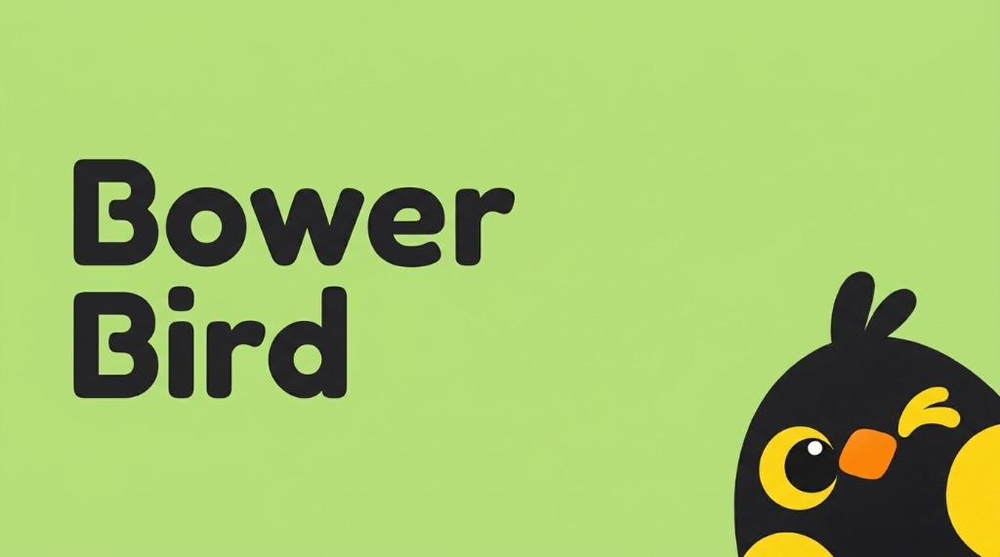

<div align="center">
  
</div>

<h1 align="center">BowerBird</h1>

<p align="center">
  <strong>Your design library, on your own disk.</strong><br>
  A local-first asset manager for people who have too many files and too little patience.
</p>

<p align="center">
  <a href="README.md">English</a> · <a href="README.zh-CN.md">简体中文</a>
</p>

<p align="center">
  <a href="https://awesomensgo.dev/apps/bowerbird"></a>
  <a href="https://awesomemygo.dev/apps/bowerbird"></a>
</p>

---

Point BowerBird at a folder of images and video and it becomes a portable `.library` package: every file is SHA-256 hashed, thumbnailed, palette-extracted, and indexed locally with SQLite. No upload, no account, no cloud.

BowerBird is a cross-platform desktop app built with **mygo's GPU-native UI (`mygo/ui`)** in Go, alongside a browser extension, plugin marketplace, Android app, and docs site in the same workspace.

## Features

- **Deduplicated, portable libraries** — Each item is stored in its own directory (`items/<id>/<filename>`) using a unique random ID, with `index.db` (SQLite, including SHA-256 `hex` for deduplication) and per-item `metadata.json`. Application settings and installed plugins stay separate in your OS user data directory.
- **Visual search & filtering** — Automatic dominant color & 6-color palette extraction, perceptual ΔE color matching, EXIF metadata, virtual folders, tags, and orientation/type filters.
- **Native preview & gallery** — Justified gallery layout, full-canvas marquee selection, inline double-click preview, Spacebar QuickLook, and native OS drag-out to external apps.
- **Extensible plugin system** — Zero-build native plugins (`markdown`, `audio`, `psd`, `prompt`, `video`, URL resolvers) plus a dual-channel plugin marketplace.

## Development & Build

All dev and build commands are defined in `package.json`. Scripts routed through `scripts/mygo.mjs` automatically set `CGO_ENABLED=1` (required for native macOS cgo bindings).

### Run in Development

```bash
pnpm dev                 # Native mygo desktop app
pnpm dev:marketplace     # Marketplace (apps/marketplace)
pnpm dev:docs            # Docs site (apps/docs)
pnpm dev:extension       # Browser extension (Chrome; :firefox also available)
```

### Build

```bash
pnpm build               # Native mygo app (current platform)
pnpm build:app:macos     # macOS universal (arm64 + amd64)
pnpm build:app:windows   # Windows amd64 (portable exe + NSIS installer)
pnpm build:app:linux     # Linux amd64

pnpm build:packages      # Shared TypeScript packages
pnpm build:extension     # Browser extension (Chrome; :firefox / :edge / :safari)
pnpm build:marketplace   # Marketplace app
pnpm build:docs          # Docs site
pnpm build:all           # All JS/TS workspace targets
```

### Test & Clean

```bash
pnpm test                # go test ./...
pnpm test:watch          # go test -count=1 -v ./...
pnpm typecheck           # Typecheck all JS/TS packages
pnpm clean               # Remove build outputs (dist, build/mygo, ...)
```

## Documentation

- [Technical Architecture](docs/ARCHITECTURE.md) — Project structure, native plugin architecture, native drag & drop, storage specification, workspace package resolution, and NSIS packaging internals.
- [Changelog](CHANGELOG.md) — Release history.
